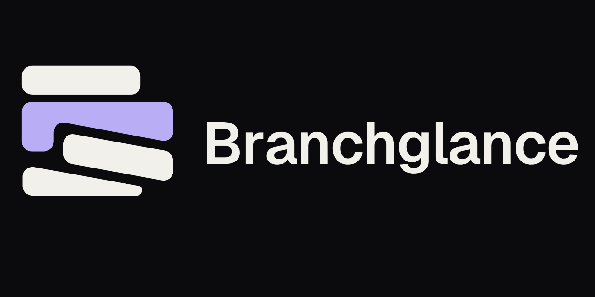
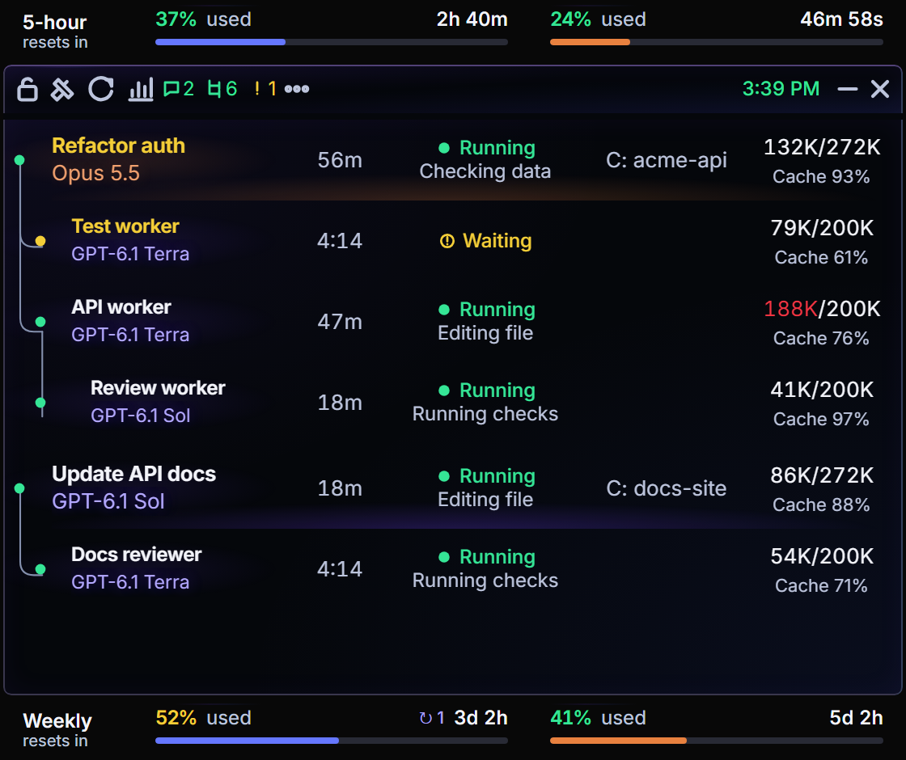
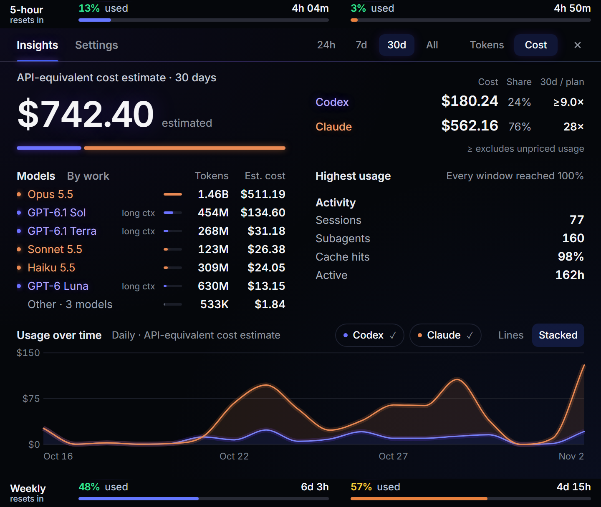

  <picture>
    <source media="(prefers-color-scheme: dark)" srcset="assets/brand/lockup-dark.svg">
    <source media="(prefers-color-scheme: light)" srcset="assets/brand/lockup-light.svg">
    
  </picture>

  
  
  
  
  

**A small always-on-top widget that shows what all your Codex and Claude Code agents are doing: which are running, which are waiting on you, and how much of your usage limits is left.**

  

> These docs describe `master`. For the latest release, use the docs at its release tag; features in [Unreleased](CHANGELOG.md) require a source build.

## Why

Running several agent chats in parallel means constantly checking which one finished, which one is stuck on a question, and how close you are to a limit. Branchglance puts that in one glanceable window, built from data already on your machine. There is no Branchglance-hosted account or service.

## What it does

> Items marked **(0.2.0)** are in the development version.

1. **One tree for both providers.** Every Codex and Claude Code chat with its subagents; Codex jobs started from a Claude chat nest under that chat. A status or parent link is shown only when there is evidence for it, otherwise it shows as unknown.
2. **Needs-you queue.** Chats waiting for input are marked and counted. Click the count to jump to the next one.
3. **Limits.** 5-hour and weekly usage for Codex and Claude side by side, with reset countdowns. Optional Claude live usage uses Claude Code's existing sign-in and refreshes about every 180 seconds (see [Privacy](#privacy)); banked Codex resets show beside the weekly bar.
4. **Insights.** Tokens, estimated cost, model breakdown, plan multiples and limit peaks over 24 hours to all time. Unpriced models are listed, never guessed.
5. **Reset actions (off by default).** A greeting that keeps Claude's 5-hour window rolling **(0.2.0)**, and a one-time `continue` queued for chats you pick.
6. **Out of the way.** It collapses to a thin strip with a clock and limit bands; hover or press Ctrl+Shift+T for the tree.

  

All screenshots use synthetic sample data.

## Quick start

**Windows (about a minute)**

1. Download `BranchglanceSetup.exe` from the [latest release](https://github.com/apratxxm/branchglance/releases).
2. Run it as your normal user, not as administrator.
3. Open **Branchglance** from the Start menu.

**macOS (from source):** `git clone https://github.com/apratxxm/branchglance.git && cd branchglance && ./macos/build.sh install`. See the [macOS guide](macos/README.md).

| Platform | Install method | Native verification | Known limits |
|---|---|---|---|
| Windows | Downloadable alpha installer or source | See each release record for tested environments | v0.1.0 is unsigned; SmartScreen may warn |
| macOS | Source build | Not natively verified | No downloadable installer; live usage needs a credentials file |

Local builds and v0.1.0 are unsigned. Signing of later releases depends on release configuration; check each release's signing status.

Details, verifying the download and uninstalling: [Install guide](docs/INSTALL.md).

## Requirements

- Windows 10 (build 19041) or 11, 64-bit, with Edge WebView2 and .NET Framework 4.8 (both ship with current Windows). The installer checks and tells you if one is missing.
- Codex signed in, for Codex chats and limits.
- Optional: Claude Code, for Claude chats and limits.
- macOS: macOS 14 or later, Python 3.10+ and the Xcode command line tools.

## Privacy

- Branchglance reads local files on your machine: Codex session data, Claude Code transcripts and hook events, and the usage cache Claude Code keeps. Transcript files are never uploaded.
- **Claude usage request (0.2.0), only with Claude tracking and live usage enabled:** Branchglance reads Claude Code's OAuth token from `.credentials.json` in memory and asks `api.anthropic.com` for your account's usage. It never refreshes, logs or stores the token. It does not use the macOS Keychain; without a credentials file it falls back to the local caches.
- Messages leave only when you enable them: reset greetings and queued Codex messages go through the provider's own CLI.
- A local loopback HTTP server serves the UI. There is no Branchglance-hosted account, analytics or sync service.
- Claude tracking, live usage, Claude hooks, the usage ledger, greetings and sending are all off until you enable them.

Full details: [Privacy](docs/PRIVACY.md) and [SECURITY.md](SECURITY.md).

## Checks

Install development dependencies and Ruff as described in [Contributing](docs/CONTRIBUTING.md), then run `python scripts/run_checks.py` from the repository root.

## Documentation

| | |
|---|---|
| [Walkthrough](docs/GUIDE.md) | Every control, and a day of use |
| [Install](docs/INSTALL.md) | Installer, verification, macOS, uninstall, troubleshooting |
| [Configuration](docs/CONFIGURATION.md) | Claude tracking, status line, ledger, greetings, environment flags |
| [Privacy](docs/PRIVACY.md) | Exactly what is read, what is sent, what is stored |
| [Architecture](docs/ARCHITECTURE.md), [Integration](docs/INTEGRATION.md) | How it works; nesting your own launchers |
| [Contributing](docs/CONTRIBUTING.md), [Releasing](docs/release/RELEASING.md) | Build from source, tests, cutting a release |
| [Changelog](CHANGELOG.md), [Code signing policy](docs/CODE_SIGNING_POLICY.md) | History and signing |

## License

[MIT](LICENSE). Third-party components keep their own licenses ([notices](THIRD_PARTY_NOTICES.md)). The Branchglance name and logo are not licensed as trademarks.
