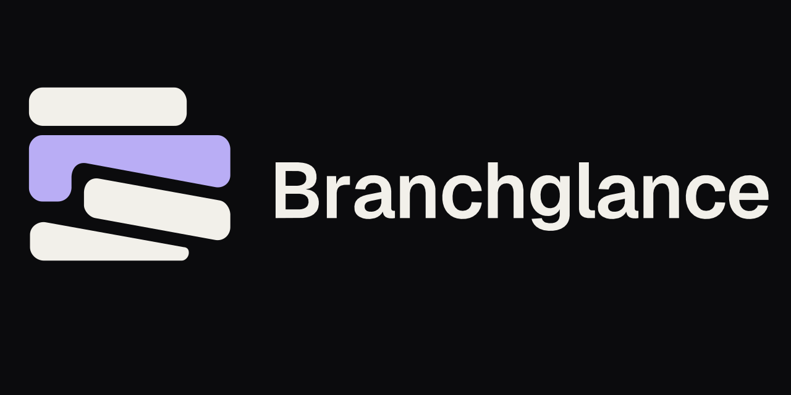
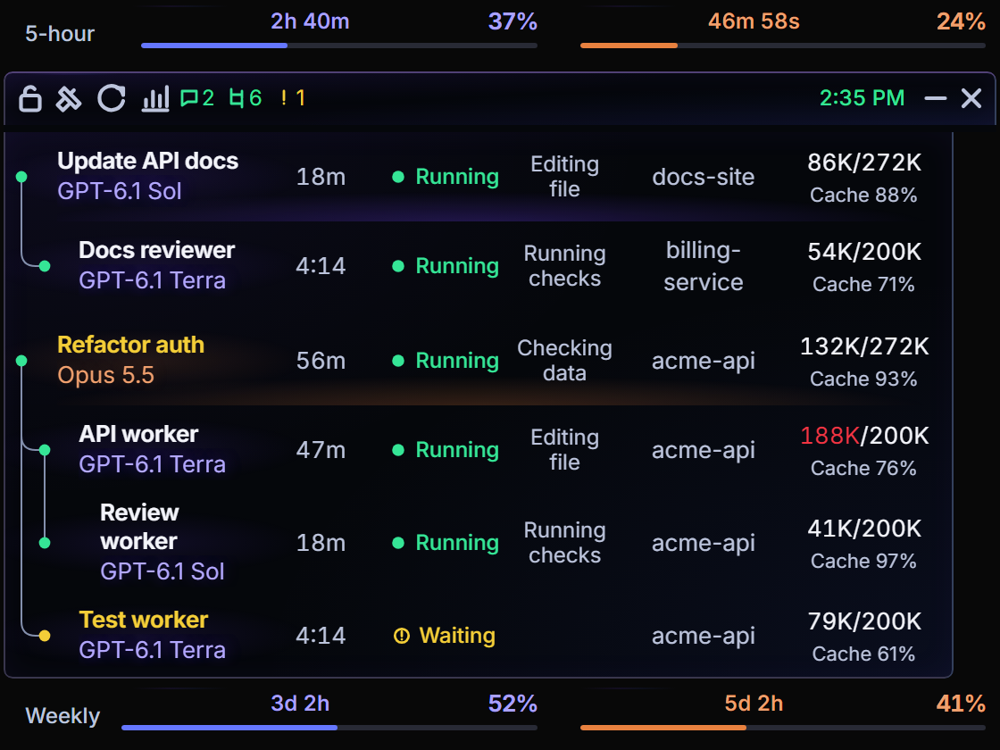
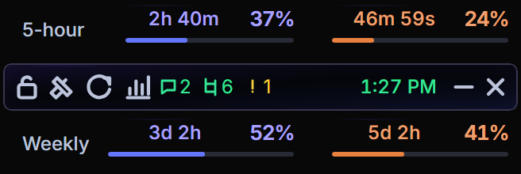

# Branchglance



[](LICENSE)


A small always-on-top Windows widget that shows what your Codex and Claude Code agents are doing: every chat and subagent in one tree, which ones are waiting on you, and how much of your 5-hour and weekly limits is left.

It is built for people who run several agent chats at once and keep losing track of which one finished, which one is stuck on a question, and how close they are to a limit.



## Features

- **One tree for both providers.** Codex chats and their subagents, Claude Code sessions and their subagents, and Codex jobs started from a Claude chat nested under that chat.
- **Needs you.** Chats waiting for input are marked in the tree and counted in the toolbar; click the count to jump to them, and open the exact chat from there.
- **Limits at a glance.** 5-hour and weekly usage for Codex and Claude side by side, with reset countdowns. A countdown reaching zero is never treated as a reset until a fresh reading confirms it.
- **Insights.** Token and cost totals over 24 hours, 7 days, 30 days or all time, a model breakdown, cache hit rate and daily limit peaks. Models without a known price are listed, never guessed.
- **Observed, not guessed.** A status is shown only when there is evidence for it. Missing data shows as unknown, and a parent link is shown only when it can be proven.
- **Out of the way.** Collapsed, it is a 328 px strip with the clock and both limit bands. Hover or press Ctrl+Shift+T to open the tree.



See the [walkthrough](docs/GUIDE.md) for every control and a typical day of use.

## Requirements

- 64-bit Windows 10 (build 19041) or Windows 11
- Microsoft Edge WebView2 Runtime and .NET Framework 4.8 (both ship with current Windows)
- Codex (CLI or app) signed in, for Codex chats and limits
- Optional: Claude Code, and Claude Desktop for Claude limits

## Install

1. Download `BranchglanceSetup.exe` from the [latest release](../../releases/latest).
2. Run it from File Explorer as your normal user (not as administrator).
3. Open Branchglance from the Start menu.

Setup installs per user to `%LOCALAPPDATA%\Programs\Branchglance`, adds Start menu and Desktop shortcuts, and can start the widget at sign-in if you choose. It checks its prerequisites and stops with an explanation if one is missing.

To check a download, compare its SHA-256 hash with the `.sha256` file published next to it, and confirm the signature:

```powershell
Get-FileHash .\BranchglanceSetup.exe -Algorithm SHA256
Get-AuthenticodeSignature .\BranchglanceSetup.exe | Format-List Status, SignerCertificate
```

To uninstall, use **Settings → Apps → Installed apps → Branchglance**. Your settings and history in `%LOCALAPPDATA%\Branchglance` are kept.

## Claude Code support

Claude Code collection is off by default. Turn it on in the widget under **Settings → Notifications → Claude tracking**. Branchglance then backs up your Claude Code `settings.json` and adds its own hooks, leaving your other hooks alone. Turning it off, or uninstalling, removes only those hooks.

The hooks record event metadata only (ids, model and tool categories, state). They never record prompts, tool inputs or outputs, full paths or chat titles.

Use `bg-codex` to nest Codex jobs under the Claude Code chat that starts them; see [the integration guide](docs/INTEGRATION.md).

## Privacy

Branchglance reads local files only: Codex session data, Claude Code transcripts and hook events, and Claude Desktop's usage cache. There is no account, server or telemetry, and nothing is uploaded.

The one exception is opt-in: if you enable a reset greeting, Branchglance runs the provider's own CLI to send a short message after a verified limit reset. It is off by default.

## Building from source

You need Python 3.10+ and Node.js (for the UI tests).

```powershell
git clone https://github.com/apratxxm/branchglance.git
cd branchglance
py -3 -m venv .venv
.\.venv\Scripts\python.exe -m pip install -r requirements-token-tracker.txt
.\.venv\Scripts\python.exe -m token_tracker.widget
```

Run the tests:

```powershell
.\.venv\Scripts\python.exe -m pytest -q
Get-ChildItem tests -Filter *.mjs | ForEach-Object { node $_.FullName }
```

Build the installer (details in [CONTRIBUTING](docs/CONTRIBUTING.md)):

```powershell
py -3.10 -m venv .build-venv
.\.build-venv\Scripts\python.exe -m pip install -r packaging/requirements-release.txt
.\.venv\Scripts\python.exe packaging/build.py --output build --python .build-venv\Scripts\python.exe
```

## Documentation

- [Walkthrough](docs/GUIDE.md): every feature and how it fits a working day
- [Client integration](docs/INTEGRATION.md): hooks, link receipts and nesting rules for your own launchers
- [Architecture](docs/ARCHITECTURE.md): how the pieces fit together
- [Contributing](docs/CONTRIBUTING.md): development setup, tests and pull requests
- [Code signing policy](docs/CODE_SIGNING_POLICY.md)

## Troubleshooting

- **Setup won't continue:** check the requirements above and run Setup from File Explorer, not from another app's terminal or as administrator.
- **Setup refuses an existing folder:** it won't overwrite files it can't identify as its own. Move the folder aside rather than deleting files to force it.
- **No Claude chats:** turn on Claude tracking in Settings. Only sessions that report hook events can appear.
- **A Codex job shows as its own parent:** its link to a Claude chat couldn't be proven. See [why a job shows up as its own parent](docs/INTEGRATION.md#why-a-job-shows-up-as-its-own-parent).
- **Limits show an age, like "13m ago":** the provider hasn't reported a fresh value yet. Claude's limits refresh when Claude Desktop does.

## Contributing

Issues and pull requests are welcome. Please read [CONTRIBUTING](docs/CONTRIBUTING.md) first. In short: branch from `master`, keep changes focused, run both test suites, and never let a test touch your real `~/.claude` or `~/.codex`.

## License

[MIT](LICENSE). Third-party components keep their own licenses; see [THIRD_PARTY_NOTICES.md](THIRD_PARTY_NOTICES.md). The Branchglance name and logo are not licensed as trademarks.
