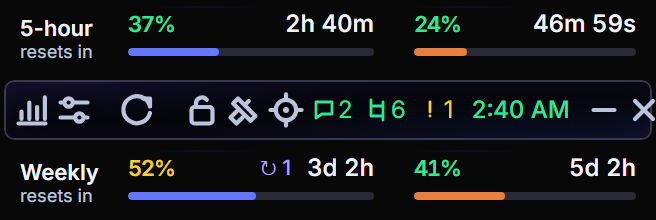

# Branchglance walkthrough

> These docs describe `master`. For the latest release, use the docs at its release tag; features in [Unreleased](../CHANGELOG.md) require a source build.

A guide to every part of Branchglance and how it fits a day of running Codex and Claude Code in parallel. It is written for power users: people who keep several chats going at once, delegate to subagents, and hit usage limits.

Behaviour below matches the current development version (0.2.0 in preparation). Where Branchglance only reports what it has observed, the guide says so.

## The idea

When work is spread across many chats and subagents, checking progress means opening each one. Branchglance keeps a small widget at the top of your screen and answers three questions at a glance:

1. **What is running?** Every Codex chat and its subagents, as a tree.
2. **What needs me?** Chats waiting for an answer are marked and counted, with a shortcut to the exact chat.
3. **How much room do I have?** Five-hour and weekly limits and their reset times, for Codex and Claude side by side.

It reads local data by default; the optional Claude live usage feature asks Anthropic for your usage (see [Privacy](PRIVACY.md)). It never answers for you, and never starts or stops work on its own. The one exception is reset actions, which you have to switch on yourself (see [Reset actions](#reset-actions)).

## A day with Branchglance

**Morning.** Open Branchglance from the Start menu, or let it start at sign-in. The collapsed widget shows the clock, live chat counts and both limit bands. If it was open before, the last snapshot appears immediately with a stale marker while fresh data loads. Stale data never shows live statuses or current limits.

**Starting work.** Kick off a few Codex chats and let them spawn workers. Each root chat appears with its subagents nested under it. Codex jobs launched from a Claude Code chat nest under that Claude chat.

**Heads-down.** Leave the widget collapsed. When something new starts or a chat asks a question, the widget can expand to show it, so you notice without switching windows.

**A chat needs you.** Its row turns yellow and shows Waiting, and the yellow `!` count in the toolbar goes up. Click the count to jump to it. For a Codex question, pick a choice: Branchglance opens that chat in Codex and tries to copy the choice. You answer in Codex.

**Limit check.** Glance at the 5-hour and weekly bands before starting something big. When you are close to a limit, open Insights to compare token use, models and cache reuse over time.

**End of the day.** If you are near the five-hour limit, you can arm a reset action: a greeting, or a one-time `continue` queued for selected chats after the next verified reset.

## The widget

### Collapsed

On Windows, the collapsed widget is 328 px wide at 100% scaling. It is a thin strip with:

- the local time (12- or 24-hour, set in Settings)
- live chat counts
- the **5-hour** limit band, and the **weekly** band beneath it

On macOS, the widget collapses into the notch instead. See the [macOS guide](../macos/README.md).

Hover over the widget to show its controls; when chats are active, hovering can also reveal the tree. Press the inspection shortcut (**Ctrl+Shift+T** by default) to open the tree directly. Move the pointer away and it collapses again, unless **Keep open** is on.

### Expanded

The dock runs left to right: **Insights**, **Settings** | **Refresh** | **Lock**, **Keep open**, **Recenter**. Refresh is an icon. Recenter is disabled while locked; its tooltip says “Unlock the widget to move it”.

The widget also shows the local clock, chat counts and search. Window controls minimize, fit, maximize or hide the widget to the tray. Press `/` or `Ctrl+K` to search.

### Providers and colours

Codex and Claude share one tree. Codex rows use a blue-violet accent; Claude rows use orange, and a Claude parent chat has a warm background. Both providers' limits share the 5-hour and weekly bands, each with its own reset time in its own colour. A provider with no data is left out.

### Tray and shortcut

The tray icon menu has **Show / hide**, **Inspection shortcut** (Ctrl+Shift+T, Ctrl+Alt+T or off), **Refresh** and **Quit**. Closing the widget hides it to the tray; it keeps monitoring.

## The chat tree

Each root chat is a row, with its subagents nested beneath it, ordered by recent activity. Large trees scroll within the expanded window, and a stopped chat stays visible for 15 minutes. Rows share column tracks, so title, model, activity, workspace and elapsed time line up down the tree. In the expanded tree, long titles wrap; in tighter layouts they can be shortened.

**What a row shows**

- the title, tidied: brief-style prefixes like `# ` and `[Project]`, and a leading word that just repeats the model name, are dropped, so `# [Orchestrator] Terra · row layout` reads as `row layout`. Other titles are left as written
- a status glyph: running (breathing), waiting, idle, failed or finished
- the model, current tool activity and time spent in the current state, when available
- context and cache figures from the last observed request

**Status is only what was observed.** Branchglance shows a status only when it has seen evidence for it. Missing or old evidence is shown as unknown, never as "stopped".

**Lineage is strict.** A subagent is nested under a chat only when its parent link is exact. A Codex job started from a Claude Code session (`codex exec resume <thread>`) nests under that Claude chat only on exact ancestry or a receipt bound to that session and process. Links that conflict, are stale or can't be verified are left out, so you never see a wrong tree. If your own scripts start Codex jobs, see [INTEGRATION.md](INTEGRATION.md) for what they need to do so the jobs nest correctly.

**Acting on a row.** The widget is for watching, not driving: rows have no general menu. A waiting Codex chat can be opened in Codex from its status, and a Claude question may offer a command to resume that session.

## Needs you

A chat waiting on you shows a yellow Waiting status in the tree, and the yellow `!` count in the toolbar shows how many there are. Click the count to jump to the next one. A Codex question with choices lists them:

- **Open in Codex** opens that chat and tries to copy the choice. You select it in Codex's own prompt.
- **Queue** sends the choice as a later message after the chat's current turn. It is not an answer to the prompt.

A Claude question shows what was observed about it and may offer a resume command.

Branchglance never submits a structured answer itself. This keeps you in control when a question needs real judgment.

## Search

Press `/` or `Ctrl+K`, or click the search icon. Plain text matches titles, agent names, models and workspaces, plus the assignment, objective and latest request or update text when available. Filters:

| Filter | Shows |
|---|---|
| `is:needs` | chats waiting for input |
| `is:running` | chats running now |
| `is:failed` | failed runs |
| `is:hidden` | chats hidden in earlier versions |

Clear the query, or press Escape, to go back to the tree.

## Limits

Each provider has a **5-hour** band and a **weekly** band. Both show percent used, from 0 to 100%. Turning amber above 50% and red above 80%, they give you time to plan before you hit a limit.

- The countdown shows when the provider said the limit resets. Zero on the countdown does not mean the limit has reset. Branchglance waits for a real sample that shows the reset.
- Codex limits come from the local Codex app server. Claude limits come from Anthropic when [live usage](CONFIGURATION.md#claude-live-usage) is on, and otherwise from the usage cache Claude Code keeps locally, or the status line helper. Claude readings are tied to the signed-in account.
- Codex **banked resets** (unused limit resets Codex reports as available) appear as a count beside the weekly bar, with their expiry in the tooltip, and drop off when they expire.
- **Routing alerts:** when one provider has under 40% of a window left while the other has room, the widget shows a one-time heads-up naming the window and its reset, so you can send work to the other provider. It re-arms after recovery or a reset, and stale readings never trigger it.
- The dot next to the Codex 5-hour label shows reset action status. Click it for details.

## Insights

Open **Insights** from the dock. The hero shows the total for the selected range and metric, followed by the provider split. Below it are **Models** (or **By work** when ledger data exists; use the segmented toggle to switch), quota, activity and chart sections.

- **Quota used** shows the current percentage and time to reset for each available provider and quota window.
- The activity strip shows **Sessions**, **Subagents**, **Cache hit rate** and **Active hours** when data is available.
- The **Daily** or **Hourly** chart has points you can inspect with the keyboard.
- Choose **24h**, **7d** or **30d**, and switch between **Tokens** and **Cost**. Use the **Refresh** icon to reload Insights.
- Partial costs are shown as lower bounds (≥); models without a known price are marked **Unpriced**. More than five models fold into **Other (n)**.
- Cost is an estimate for comparison, not a bill.

Use it to see what is eating your allowance: a model you didn't mean to use, a heavy day, or low cache reuse. It doesn't break usage down by individual chat.

## Settings

The **Settings** tab sits next to Insights. Its sections appear in this order:

1. **Widget:** lock position, keep the widget open, choose 12- or 24-hour time, and use **Position** (or **Monitor** when multiple displays are available) › **Recenter** to return it to the centre of the current screen. Recenter is disabled while locked and says “Unlock the widget to move it”.
2. **Providers:** shows the show, collect and send flags from the policy file; these are read-only here.
3. **After a Codex quota reset:** configure reset actions.
4. **Plan price:** set monthly plan prices used by the “30d vs plan” comparison.
5. **About:** shows the version and build and provides a privacy-filtered bug report to create, copy or open in a GitHub issue. For a report file, see [Attaching a debug report](CONTRIBUTING.md#attaching-a-debug-report).

Close the panel with **×** or **Escape** to return to the widget. Focus returns to the button that opened it.

## Reset actions

Off by default. Configure them from Settings or the reset-action status pop-up. Each applies to a verified reset. The greeting recurs while enabled (Claude may send a first greeting to establish a window); `continue` is one-shot:

- **Greeting:** sends a short greeting through the provider's own CLI once a real reset is observed. This sends a request to that provider. A greeting does not reset your allowance and does not prove work finished.
- **Continue selected chats once:** with the needed Codex permissions, queues the exact message `continue` for eligible chats you pick, after the next verified reset. Chats that are active or can't be verified are skipped. Queued doesn't mean started.

Before acting, Branchglance checks again that the reset is real and records each delivery to avoid repeats. A greeting that fails can be retried.

## Claude Code

Claude collection is off until you turn it on in **Claude tracking**.

- Turning it on backs up your existing Claude Code settings file, then adds Branchglance-owned hooks. Your other hooks stay as they are.
- The hooks record event metadata only: identifiers, model and tool categories, state, and the workspace drive and final folder name. They never record prompts, tool inputs or outputs, full paths or chat titles. Titles are read from local transcripts for display only.
- Branchglance uses `CLAUDE_CONFIG_DIR` if set, otherwise `~/.claude`. The settings file it edits is recorded, so turning tracking off or uninstalling edits that same file.
- Claude rows and subagents appear only when Claude Code reports hook events for them. Coverage across real sessions has not been fully established yet.
- Turning it off revokes consent and removes Branchglance's hooks. If removal isn't safe or fails, the hooks left behind are reported.

## Install, update and remove

Installing, updating, rolling back and uninstalling are covered in the [install guide](INSTALL.md). Setup installs per user, and the uninstaller removes only Branchglance's own hooks, shortcuts and program files, and keeps and reports anything it can't safely remove. Your settings and history stay unless you delete them.

## Power-user tips

- **Keep the widget collapsed.** The limit bands and counts are enough most of the time, and the widget expands when something needs you.
- **Bind the shortcut.** Ctrl+Shift+T opens the full tree without touching the mouse. If it clashes with another app, switch to Ctrl+Alt+T from the tray menu.
- **Search with filters.** `is:needs` gives you a queue of chats to answer. `is:failed` after a long run shows what to retry.
- **Plan around the weekly band,** not just the 5-hour one. Check Insights → 7d before a big parallel run.
- **Arm `continue` before a limit hits.** After the next verified reset, Branchglance queues `continue` for the chats you picked, so they can pick up again without you.
- **Lock the widget** on a multi-monitor setup, and use Recenter after docking or undocking a laptop.

## Limits of what it knows

- Statuses are observed, not inferred. Silence is not shown as idle.
- Reset times come from the provider; a countdown alone proves nothing.
- Cost is estimated from known prices only.
- Claude subagent coverage depends on hook events.
- Windows has an installer; macOS runs from source. See the [macOS guide](../macos/README.md).
- Environment overrides are listed in [Configuration](CONFIGURATION.md).

For how it works inside, see [ARCHITECTURE.md](ARCHITECTURE.md).
